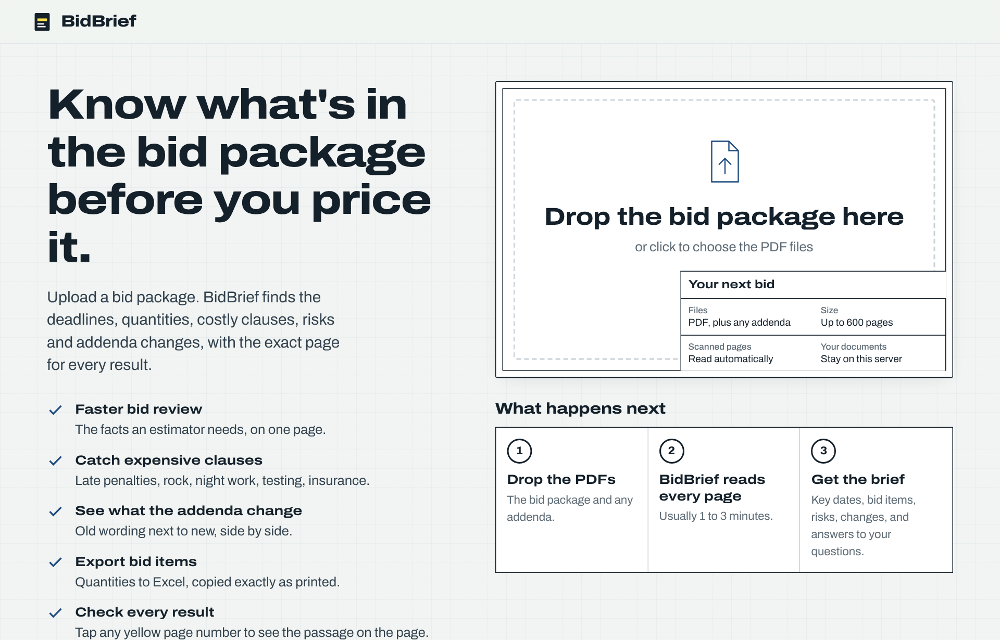
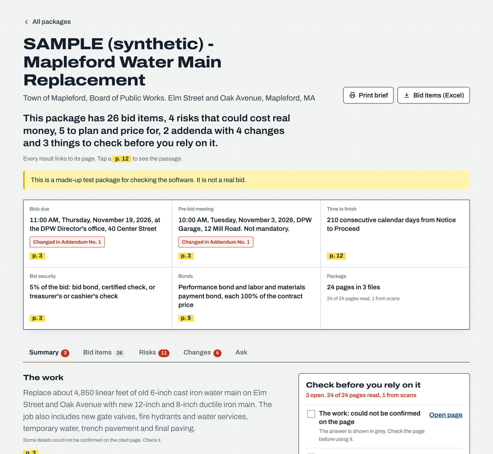
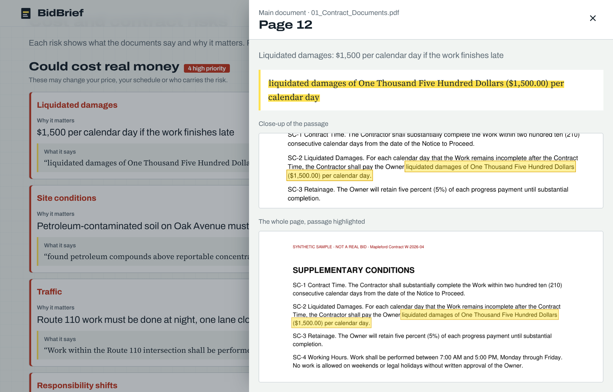
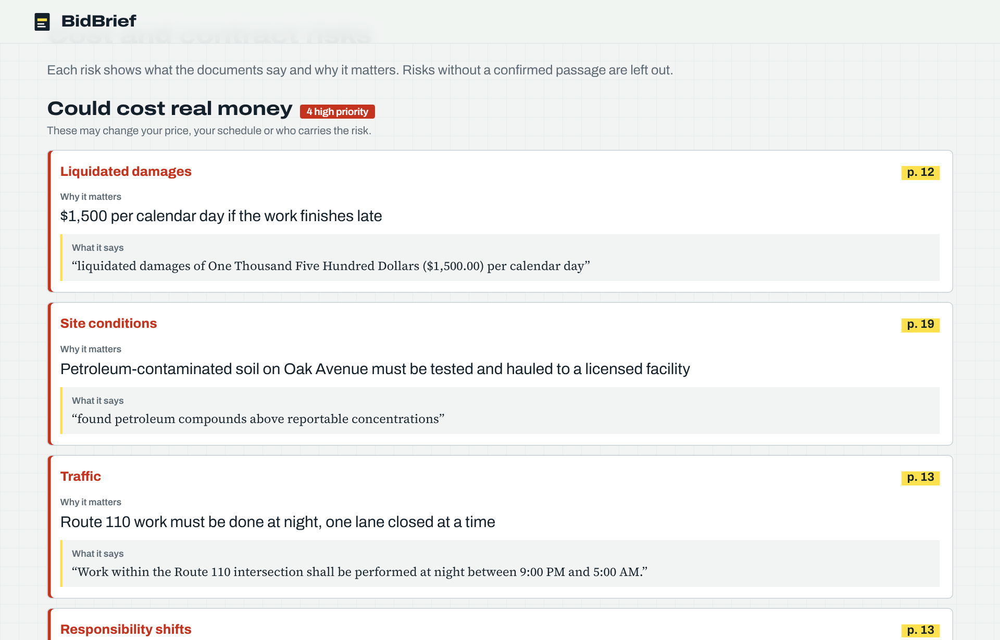
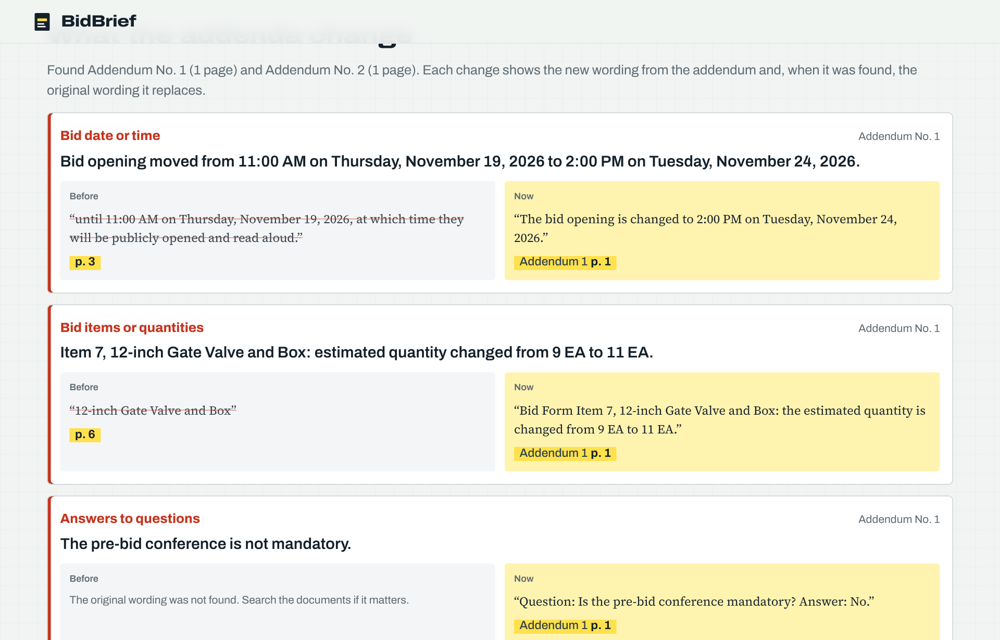
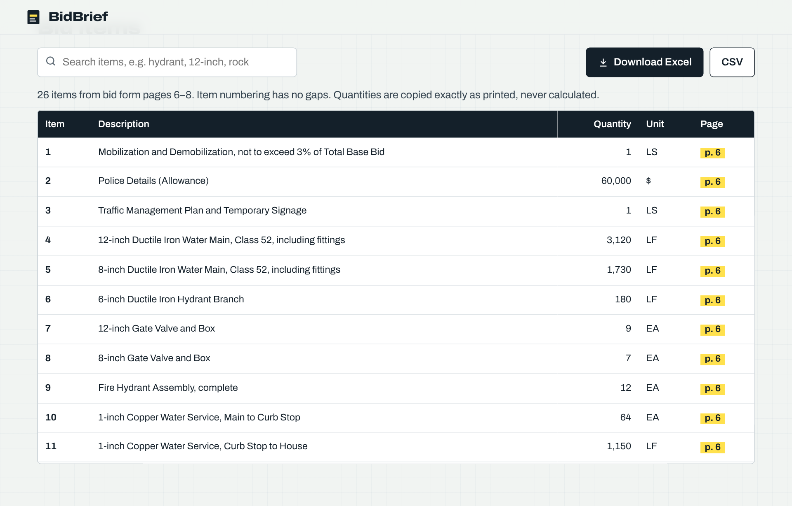
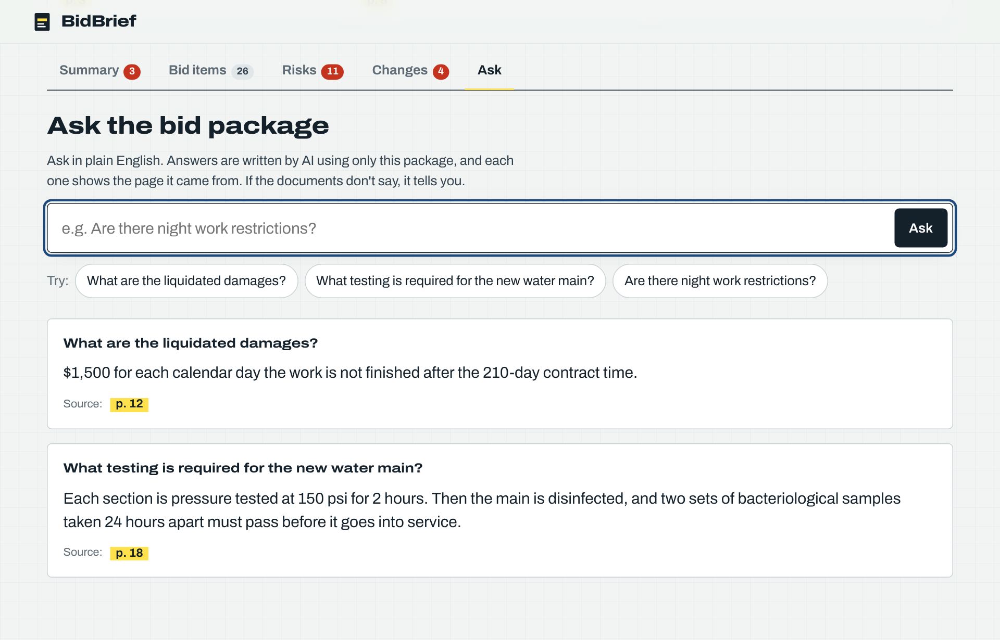
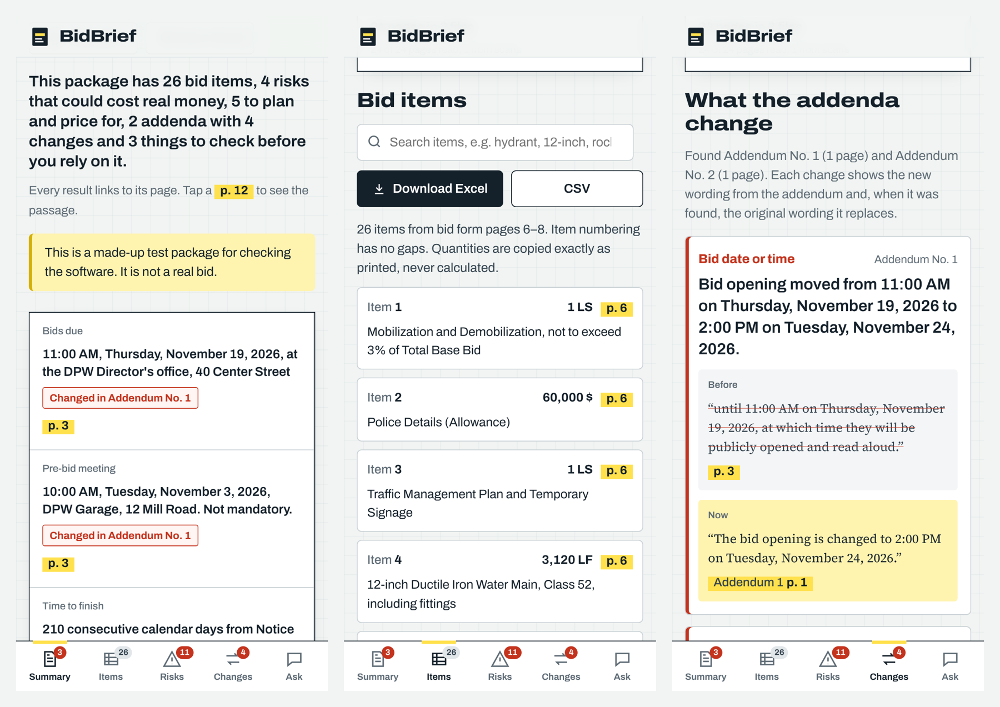
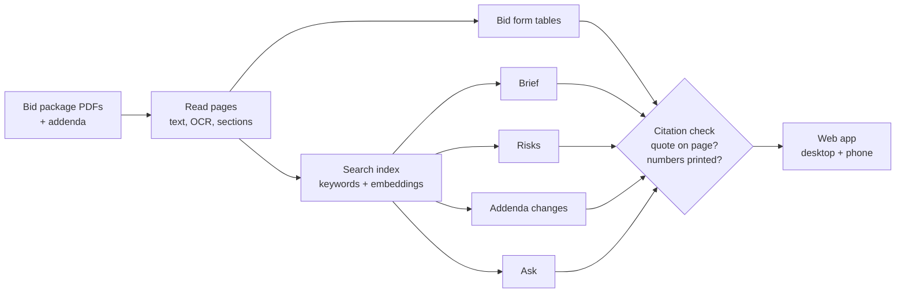

<div align="center">

# BidBrief

**Know what's in the bid package before you price it.**

Upload a public construction bid package. BidBrief reads every page and gives the estimator the key dates, the bid items in Excel, the risks that could cost money, what the addenda change, and answers to questions, each linked to the exact page it came from.



</div>

> The screenshots use the built-in **synthetic** test package (`python -m bidbrief sample`), which is made up and labeled as such. Real results come from public bid packages listed in [data/SOURCES.md](data/SOURCES.md).

---

## The problem

Before a heavy-civil contractor decides whether to bid a water, sewer, drainage or roadway job, someone has to read the whole package: the bid form, the general and supplementary conditions, the specifications, the addenda. That is hours or days per job. Missing one clause, such as a daily penalty for finishing late, rock the contractor must remove at no extra cost, or a bid date moved by an addendum, can turn a won job into a loss.

BidBrief gives the estimator a head start and shows exactly where to look. It does not price the job or decide whether to bid. A person always makes that call.

## What it does

### 1. A one-page brief, every line cited

The key facts sit in a title block like the one on a drawing sheet. A one-line summary at the top says what matters, and a checklist shows what a person should confirm before relying on it.



### 2. Every result opens the page it came from

Tap any yellow page number. The page opens with the quoted passage highlighted, plus a close-up you can read on a phone.



### 3. Risks, in plain words

Grouped by what they mean for the bid: *could cost real money*, *plan and price for it*, *good to know*. Each risk shows **why it matters** and **what the documents say**.



### 4. What the addenda change

BidBrief finds the addenda and lists every change, with the original wording next to the new wording. A revised bid-form row is compared exactly by code, and facts an addendum changes get a red tag on the summary.



### 5. Bid items, straight to Excel

The bid form becomes a searchable table. Quantities are copied exactly as printed, never calculated or rounded. Rows the parser is unsure of are tinted for a person to check, and gaps in item numbering are reported.



### 6. Ask the bid package

Plain-English questions get a short answer with its source page. Answers are written by AI using only the package. If the documents don't say, BidBrief says so and shows the closest pages it checked.



### 7. Built for a phone too

A bottom tab bar, bid items as cards, and a full-screen page viewer.



---

## Why you can trust the output

**The citation check is the core of the design.** Every claim the model writes must come with a quote and a page. Code, never the model, then:

1. **Confirms the quote is on that page** (fuzzy match of 0.9 or higher). If the quote is on another page the model was shown, code moves the citation there.
2. **Checks every number.** Every number in a claim must be printed in its verified quotes, so nothing is computed, rounded or converted. Writing "60 days" when the page says "sixty days" fails the check.
3. **Drops or flags what fails.** Risks and changes without a confirmed passage are left out. Brief fields and answers that fail are shown in grey as unverified and added to the checklist.

What could not be read (a scanned page without OCR, for example) is listed for a person, never guessed.

## How it works



| Step | Tools |
|---|---|
| PDF text, word positions, page images | PyMuPDF |
| Bid form tables | pdfplumber, then word-position line parsing, then the model on the page image as a last resort |
| Scanned pages | ocrmypdf + Tesseract (falls back to PyMuPDF + Tesseract) |
| Search | BM25 keywords + `bge-small-en-v1.5` embeddings (fastembed, ONNX, CPU only), reciprocal-rank fusion, MiniLM cross-encoder rerank |
| Model | Gemini Flash with JSON output validated by Pydantic, retried once if invalid. A local Qwen through any OpenAI-compatible server also works |
| Web app | FastAPI and a hand-built HTML/CSS/JS frontend with no build step and self-hosted fonts |

Model calls are rate limited and cached on disk, so re-runs and the evaluation cost nothing extra.

## Evaluation

Measured against hand-made answer keys with `python -m bidbrief.eval`. These are the real numbers, including the weak ones.

> To be filled in from `EVAL_RESULTS.md` after running on the three real public packages. The synthetic sample is not used for these numbers.

| What | Package 1 | Package 2 | Package 3 (messy) | Target |
|---|---|---|---|---|
| Bid items matched exactly | | | | 95%+ on clean forms |
| Bid items missed / invented | | | | invented = 0 |
| Brief fields correct with the right page | | | | 90%+ |
| Answers correct and cited to the right page | | | | 85%+ |
| Unanswerable questions marked "not found" | | | | 90%+ |
| Shown quotes that appear on the cited page | 100% | 100% | 100% | 100% (enforced) |
| Real risks found / false flags | | | | report both |
| Time to process | | | | under 3 min for 300 pages |

Every failure gets one line with its cause (bad OCR, table split across pages, retrieval missed the page, model misread it). The biggest cause is fixed and the evaluation re-run:

```bash
python -m bidbrief.eval --label baseline
python -m bidbrief.eval --label "after fix" --compare     # before/after table
```

## Run it

```bash
git clone https://github.com/Delimiter-Ashish/bidbrief.git && cd bidbrief
python3 -m venv bidbrf && source bidbrf/bin/activate
pip install -r requirements.txt
cp .env.example .env              # add your GEMINI_API_KEY
python -m bidbrief doctor --ping  # checks the setup
python -m pytest                  # 35 tests, offline

python -m bidbrief sample                                   # synthetic test package
python -m bidbrief process data/packages/sample-mapleford   # or your own package folder
python -m bidbrief serve --port 8501                        # open http://localhost:8501
```

Tesseract is optional (`apt install tesseract-ocr` or `brew install tesseract`). On BU SCC without root, use `scripts/setup_scc.sh` and `scripts/install_ocr_scc.sh`; see [START_HERE.md](START_HERE.md).

**Letting someone try it.** Uploads can be limited with access codes (`python -m bidbrief new-code --prefix NAME --uses 3`). A package added with a code is visible only with that code, and its owner can delete it. Without codes, uploads are open, which is fine on a private machine but not on a public link.

**Hosting.** The `Dockerfile` runs as is on a Hugging Face Docker Space or any container host. Set `GEMINI_API_KEY`, `BIDBRIEF_TRIAL_CODES` and `BIDBRIEF_CONTACT` as secrets.

<details>
<summary>Command line reference</summary>

```text
python -m bidbrief doctor [--download] [--ping]   check the setup
python -m bidbrief sample                          build the synthetic test package and answer key
python -m bidbrief process <folder>                process one package
python -m bidbrief process-all                     process every folder in data/packages
python -m bidbrief list                            list processed packages
python -m bidbrief ask <package_id> "question"     ask from the terminal
python -m bidbrief serve [--port 8501]             start the web app
python -m bidbrief new-code --prefix NAME --uses 3 make a trial access code
python -m bidbrief trials                          show trial code usage
python -m bidbrief.eval [--compare]                run the evaluation
```
</details>

<details>
<summary>Project layout</summary>

```text
bidbrief/
  ingest.py      PDF text, pages, sections, OCR, chunks with offsets
  tables.py      bid form detection and extraction, Excel/CSV
  index.py       BM25 + embeddings, fusion, rerank
  llm.py         model calls, JSON validation, retry, rate limit, cache
  citations.py   quote verification, numbers check, highlight boxes
  brief.py  risks.py  ask.py
  changes.py     addenda: find them, list changes, compare revised bid rows
  pipeline.py    runs a package end to end, saves results
  server.py      web API: packages, page images, downloads, ask, uploads
  trials.py      access codes and who can see which package
  web/           frontend (index.html, styles.css, app.js, fonts)
  eval.py        metrics, error analysis, before/after
  sample.py      synthetic test package + answer key
tests/           35 tests that run offline with a stand-in model
data/            packages, answer keys, results, SOURCES.md
scripts/         SCC setup, OCR install, app launcher, batch job
```
</details>

## Data

Only publicly posted bid documents are used. Sources, URLs and download dates are recorded in [data/SOURCES.md](data/SOURCES.md).

## Limits and next steps

- Drawings (plan sheets) are images; reading them needs a vision step. That is the planned next version.
- Risk severity is the model's judgment from a fixed guide. The cited passage is always there to check.
- Answers never use outside knowledge about construction law or practice, by design. BidBrief shows the clause; the estimator decides what to do about it.

---

Built by **Ashish Joshi** (M.S. Artificial Intelligence, Boston University).
