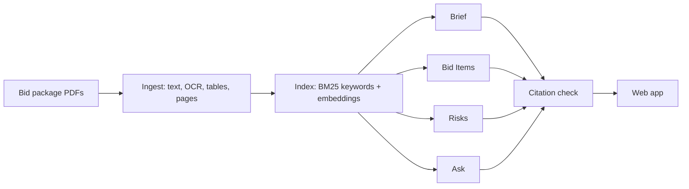

# BidBrief

**BidBrief reads a public construction bid package of several hundred pages and gives an estimator a one-page brief, the bid items as a spreadsheet, a list of risks, and answers to questions, each with the page it came from.**


<!-- Record a short GIF of the Brief tab on a real package and save it as docs/brief.gif -->

## The problem

Before a heavy-civil contractor decides whether to bid a water, sewer or roadway job, someone reads the whole package: the bid form, the general and supplementary conditions, the specifications and the drawings list. That takes hours or days per job. Missing one clause, such as a high daily penalty for late finish or an unusual testing requirement, can turn a won job into a loss.

## What it does and does not do

It does:
- **Brief**: project, owner, location, plain-English scope, bid due date, pre-bid meeting, completion time, bid security, bonds, and the five pages to read first. Each field cites its page, or says "Not found in the documents".
- **Bid Items**: the bid form as a table and an Excel/CSV download. Quantities are copied exactly as printed. Rows the parser is unsure of are tinted yellow for a person to check, and gaps in the item numbering are reported.
- **Risks**: flags in nine fixed categories (schedule, liquidated damages, payment, bonds and insurance, site conditions, traffic, testing, responsibility shifts, labor), each with a severity and a cited passage.
- **Ask**: a question box. Answers are 1 to 4 sentences with citations. If the documents do not answer it, it says so and shows the closest pages it checked. Conflicting passages are shown side by side.
- **Changes**: finds the addenda and lists what each one changes, with the original wording next to the new wording. Revised bid-form rows are compared exactly by code, and facts an addendum changes are marked in red.
- **Check before you rely on it**: one list of everything a person should look at, such as unreadable pages, results that could not be confirmed on the page, bid rows the parser is unsure of, gaps in item numbers and values an addendum changed. Items can be ticked off.
- **Every citation** opens the page with the quoted passage highlighted in yellow, with a close-up of the passage.
- **Print brief** gives a paper copy of the summary, risks and bid items.

It does not price the job, decide whether to bid, read drawings (plan sheets), compare addenda, or replace reading the contract. A person always makes the decision.

## Evaluation

Measured on hand-made answer keys (`python -m bidbrief.eval`). These are the real numbers, including the weak ones.

> Fill this table from `EVAL_RESULTS.md` after running the evaluation on the three real packages. Do not use the synthetic sample's numbers here.

| What | Package 1 | Package 2 | Package 3 (messy) | Target |
|---|---|---|---|---|
| Bid items matched exactly | | | | 95%+ on clean forms |
| Bid items missed / invented | | | | invented = 0 |
| Brief fields correct with the right page | | | | 90%+ |
| Answers correct and cited to the right page | | | | 85%+ |
| Unanswerable questions marked "not found" | | | | 90%+ |
| Shown quotes that appear on the cited page | 100% | 100% | 100% | 100% (enforced) |
| Real risks found / false flags | | | | report both |
| Time to process | | | | under 3 min for 300 pages |

**Error analysis.** Every failure gets one line with its cause (bad OCR, table split across pages, retrieval missed the page, model misread it). The biggest cause gets fixed and the evaluation is re-run:

```bash
python -m bidbrief.eval --label baseline
# ...fix the biggest cause...
python -m bidbrief.eval --label "after fix" --compare     # prints the before-and-after table
```

## How it works



**The citation check is the core of the design.** Every claim the model writes must include a quote and a page. Code, never the model, then confirms the quote appears on that page (fuzzy match of 0.9 or higher on normalized text). If the quote is on a neighbouring excerpt page instead, code moves the citation to the right page. A second guard checks that every number in a claim is printed in its verified quotes, so nothing is computed, rounded or converted. Claims that fail are dropped (risks) or shown grey as "unverified" (brief fields, answers).

| Step | Tool |
|---|---|
| PDF text, word positions, page images | PyMuPDF |
| Bid form tables | pdfplumber, then word-position line parsing, then the model on the page image as a last resort |
| OCR for scanned pages | ocrmypdf + Tesseract (falls back to PyMuPDF + Tesseract) |
| Search | BM25 + `bge-small-en-v1.5` embeddings (fastembed, ONNX, no GPU needed), reciprocal-rank fusion, MiniLM cross-encoder rerank |
| Model | Gemini Flash with JSON output validated by Pydantic, retried once if invalid; or a local Qwen through any OpenAI-compatible server |
| App | FastAPI backend and a hand-built HTML/CSS/JS frontend (no build step, fonts self-hosted); the cited page is rendered as an image with a yellow box drawn over the quote's word coordinates, plus a close-up of the passage |

Every model call is rate limited and cached on disk, so re-runs and the evaluation cost nothing extra, and the three demo packages are pre-computed so free-tier limits never break the demo.

## Data

Only publicly posted bid documents are used. Sources, URLs and download dates are in [data/SOURCES.md](data/SOURCES.md). A synthetic package (`python -m bidbrief sample`) exists only for tests; it is marked as synthetic on every page and in the app.

## Run it

### On BU SCC

```bash
unzip bidbrief.zip && cd bidbrief
BIG_DIR=/projectnb/<project>/<you> bash scripts/setup_scc.sh   # makes the "bidbrf" venv, downloads search models
source scripts/env.sh                                          # every new session
nano .env                                                      # paste GEMINI_API_KEY
python -m bidbrief doctor --ping                               # checks everything, makes one tiny model call
python -m pytest                                               # 39 tests
```

Process packages (put each package's PDFs in its own folder under `data/packages/`):

```bash
python -m bidbrief sample                                  # synthetic test package (optional)
python -m bidbrief process data/packages/<folder>          # one package
python -m bidbrief process-all                             # all of them
python -m bidbrief ask <package_id> "What are the liquidated damages?"
qsub scripts/process_all.qsub                              # or as a batch job
```

Start the web app:

```bash
python -m bidbrief serve --port 8501       # or: bash scripts/run_app.sh
```

In SCC OnDemand (VS Code), open port 8501 from the **PORTS** tab. From a laptop terminal, `scripts/run_app.sh` prints the `ssh -L` tunnel command.

### Anywhere else

```bash
python3 -m venv bidbrf && source bidbrf/bin/activate
pip install -r requirements.txt
cp .env.example .env    # add GEMINI_API_KEY
python -m bidbrief serve
```

Tesseract is optional (`apt install tesseract-ocr` / `brew install tesseract`; on SCC without root: `BIG_DIR=... bash scripts/install_ocr_scc.sh`). Without it, scanned pages are listed under "Check before you rely on it".

### Letting someone try it with their own documents

Uploads can be limited with access codes. Each code allows a set number of packages, and a package added with a code is visible only to people who enter that same code. The pre-loaded public packages stay visible to everyone.

```bash
python -m bidbrief new-code --prefix SEAN --uses 3    # prints a code and the .env line
# add to .env:  BIDBRIEF_TRIAL_CODES=SEAN-XXXX-XXXX:3   (comma-separate several codes)
python -m bidbrief trials                             # how many each code has used
```

A trial is counted only when a package finishes. If processing fails, it is given back. Without any codes set, uploads are open to anyone who can reach the app, which is fine on SCC but not on a public link. The person who added a package can delete it from the app.

Use a paid-tier Gemini key for real customer documents. Ask people to upload public bid packages only.

### Hosting the demo

SCC OnDemand links only work for BU accounts, so share a hosted copy. Process the public packages first and commit `data/packages`, `data/work` and `data/results` so the demo loads instantly.

- **Hugging Face Spaces**: create a Docker Space, push the repo (the `Dockerfile` is ready), and add `GEMINI_API_KEY`, `BIDBRIEF_TRIAL_CODES` and `BIDBRIEF_CONTACT` as Space secrets. Free Spaces reset their disk on restart, which also resets trial counts.
- Any server with Docker: `docker build -t bidbrief . && docker run -p 7860:7860 --env-file .env bidbrief`.

## Settings

All settings are environment variables (see `.env.example`): `BIDBRIEF_LLM` (`gemini`, `openai`, `none`), `GEMINI_API_KEY`, `GEMINI_MODEL`, `LLM_RPM`, `OPENAI_BASE_URL`/`OPENAI_MODEL` for a local model, `BIDBRIEF_MODEL_CACHE`, `BIDBRIEF_EMBEDDINGS`, `BIDBRIEF_RERANK`, `BIDBRIEF_QUOTE_THRESHOLD` (default 90).

## Project layout

```
bidbrief/
  ingest.py      PDF text, pages, sections, OCR, chunks with offsets
  tables.py      bid form detection and extraction, Excel/CSV
  index.py       BM25 + embeddings, fusion, rerank
  llm.py         model calls, JSON validation, retry, rate limit, cache
  citations.py   quote verification, numbers guard, highlight boxes
  brief.py  risks.py  ask.py
  changes.py     addenda: find them, list changes, compare revised bid rows
  pipeline.py    runs a package end to end, saves results
  eval.py        metrics, error analysis, before/after
  sample.py      synthetic test package + answer key
  schemas.py     Pydantic models
  server.py      web API: packages, page images, downloads, ask, uploads
  trials.py      access codes, trial counts, who can see which package
  web/           the frontend (index.html, styles.css, app.js, fonts)
tests/           39 tests, run offline with a stand-in model
data/            packages, answer keys, results, SOURCES.md
scripts/         SCC setup, app launcher, batch job
```

## Limits and next steps

- Drawings are images; reading plan sheets needs a vision step (version 2).
- Addenda are read but not compared against the original documents.
- Severity is the model's judgment from a fixed guide; the cited passage is always there to check.
- Answers never use outside knowledge about construction law or practice, by design.
